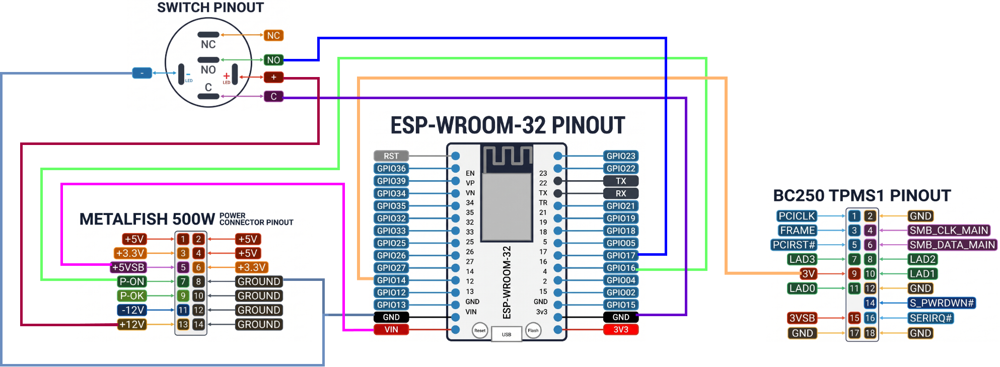
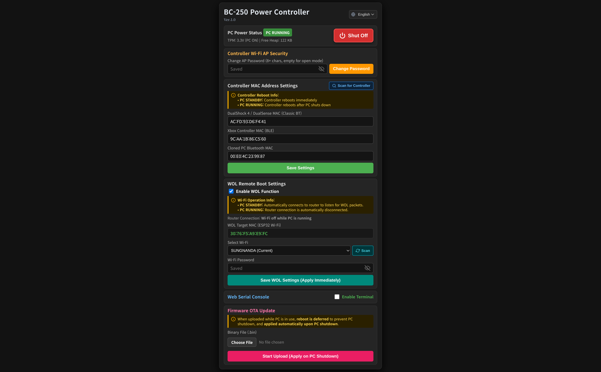
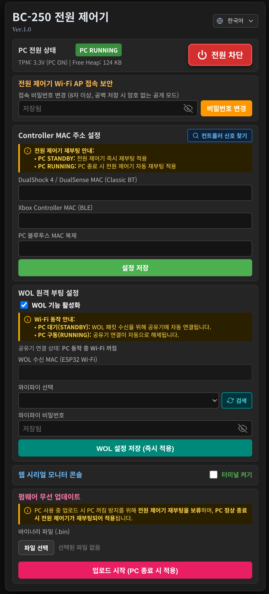

**Select Language:** [ English ](#esp32-bc-250-power-controller) | [ 한국어 ](#esp32-bc-250-power-controller-kr)

---

# ESP32 BC-250 Power Controller

An ESP32-based power controller project designed to boot and manage AMD BC-250 systems using Bluetooth controllers (DualSense via Classic BT, Xbox via BLE), Wake-on-LAN (WOL), or a responsive Web UI.

By adopting **Passive Sniffing**, it eliminates pairing and handover conflicts with the PC's Bluetooth dongle upon boot. The firmware includes a built-in responsive web dashboard, Web Serial console, and wireless Over-The-Air (OTA) updates.

> **General Desktop (ATX) & Bazzite OS Application Note**  
> The hardware wiring and setup instructions in this guide are primarily verified on the **AMD BC-250 + MetalFish Flex ATX power supply**. However, because the control logic is identical, this project can be adapted for **wireless WOL setups on desktop PCs operating solely on Wi-Fi** or **living room gaming rigs running Bazzite OS / SteamOS**.  
> *(Note: When adapting to a standard ATX system, verifying standard 24-pin power connector pinouts (`+5VSB`, `PS_ON`) and matching the 3.3V logic level for motherboard state sensing pins (`PWR_LED+`) must be configured by the user according to their hardware specifications.)*

---

## 1. Demo Video

- **Demo Video:** [](https://youtu.be/mG9zLRV9HGY)
- Demonstrates system boot trigger via gamepad input and Web UI with real-time feedback.

---

## 2. Features

1. **Direct ESP32 Interface**
   - Directly controls the power supply `PS_ON` signal using the ESP32's open-drain mode (`OUTPUT_OPEN_DRAIN`) without requiring relays, photocouplers, or MOSFETs.
   - Note on ESP32 GPIO voltage tolerance: While the absolute maximum ratings in the datasheet state (VDD + 0.6V), direct control has been empirically validated across numerous projects. (Optional photocoupler or MOSFET isolation can still be added based on preference. See **Section 7**.)

2. **Passive Bluetooth Sniffing (Zero Handover Conflict)**
   - The ESP32 does not pair with the controller; instead, it clones the PC Bluetooth dongle's MAC address and monitors the paging/broadcast packets sent by the gamepad.
   - Upon detecting the wake-up packet, the ESP32 immediately shuts down its internal Bluetooth stack (`killBluetoothStack`), allowing the controller to connect to the PC dongle seamlessly once the OS boots.
   - **Why clone the dongle MAC?** Classic BT controllers only transmit 1:1 paging packets to their bonded host dongle. By spoofing the dongle's MAC address, the ESP32 passes hardware packet filtering (sniffing) and immediately releases the radio stack, preventing connection conflicts. (No separate pairing or multi-device profile switching is needed on the controller.)

3. **Closed-Loop Power State Sensing**
   - Instead of blind toggling, the controller monitors the BC-250 motherboard's power state pin (`TPMS1` header pin 9, 3.3V) to determine actual runtime status.
   - Powering on the controller while the PC is already running will not trigger unintended resets or forced shutdowns.

4. **Web Dashboard & Real-Time Web Serial Console**
   - Connect to the ESP32 SoftAP (`http://192.168.4.1`) from any smartphone or PC browser to manage power, configure Wi-Fi credentials, register controller MAC addresses, and monitor status.
   - A built-in Web Serial console allows real-time debugging and command execution without a physical USB serial connection.

5. **Wireless OTA Firmware Updates**
   - Update firmware wirelessly by uploading compiled `*.bin` binaries directly via the web dashboard.

6. **Wake-on-LAN (WOL)**
   - Supports magic packet reception on UDP ports 7, 9, and 2304 (compatible with router apps such as ipTIME).
   - Enables WOL functionality for systems operating exclusively over Wi-Fi.
   - Automatically detects and displays the ESP32's MAC address on the Web UI.

---

## 3. Hardware Components

Components used in this reference implementation:

| Category | Component | Specification | Notes |
| :--- | :--- | :--- | :--- |
| **MCU** | ESP32 Development Board | ESP-WROOM-32 (NodeMCU 30-Pin / 38-Pin) | Wi-Fi, Classic BT, BLE Sniffing & Control |
| **Power Supply** | Flex ATX PSU | MetalFish Flex ATX or equivalent | Requires `+5VSB` (Standby 5V) and `PS_ON` |
| **Switch** | Momentary Push Button | 12V LED illuminated momentary (16mm / 19mm) | NO/C contacts (Power trigger & LED status) |
| **Target System** | AMD BC-250 | Motherboard with TPMS1 header | Pin 9 provides 3.3V runtime status sensing |
| **Wiring** | Jumper Wires | Male-to-Female / Female-to-Female DuPont cables | Header pin interconnections |
| **Optional** | Isolation Circuit | PC817 Photocoupler (220–330Ω resistor) or N-MOSFET | Used if electrical circuit isolation is desired |

---

## 4. Hardware Wiring

```text
[MetalFish Power Supply]
- Pin 5  (+5VSB Standby 5V) ───────> ESP32 VIN
- Pin 8  (GND)              ───────> ESP32 GND (Left)
- Pin 7  (PS_ON Control)    ───────> ESP32 GPIO 16 (OUTPUT_OPEN_DRAIN)
- Pin 13 (+12V Indicator)   ───────> Front Switch LED (+)

[BC-250 Motherboard (TPMS1 Header)]
- Pin 9  (3.3V State Sense) ───────> ESP32 GPIO 14 (INPUT)

[Front Momentary Switch]
- NO (Normally Open) Terminal ─────> ESP32 GPIO 17 (INPUT_PULLUP)
- C (Common) Terminal         ─────> ESP32 GND (Right)
- LED (-) Terminal            ─────> ESP32 GND
```

<br>



---

## 5. Firmware Build & Flash

### 5.1 PlatformIO (VS Code) - Recommended
This project is configured natively for **PlatformIO**, handling dependencies and partition schemes automatically.

1. Install the **PlatformIO IDE** extension in VS Code.
2. Open the repository root folder and verify `platformio.ini` loads correctly.
3. Connect the ESP32 to your PC via USB and click the **Upload (→)** button in the bottom status bar.
4. **For subsequent wireless OTA updates:**
   - Upload the generated `.pio/build/esp32dev/firmware.bin` through the Web UI dashboard OTA menu.

### 5.2 Arduino IDE Setup
For compiling via Arduino IDE, download the packaged single-sketch release archive.

- **Download:** Get `BC250_ESP32_Power_Controller_Ver.1.0.zip` from the [Releases Tab](../../releases).

1. **Install ESP32 Board Support:**  
   In Arduino IDE, go to `File` -> `Preferences` -> `Additional Boards Manager URLs`, add the URL below, and install **esp32** via the Boards Manager:
   ```text
   [https://raw.githubusercontent.com/espressif/arduino-esp32/gh-pages/package_esp32_index.json](https://raw.githubusercontent.com/espressif/arduino-esp32/gh-pages/package_esp32_index.json)
   ```
2. **Open Sketch:**  
   Extract the downloaded zip archive and open `BC250_ESP32_Power_Controller_Ver.1.0.ino` located inside the `BC250_ESP32_Power_Controller_Ver.1.0` folder.
3. **Select Board:**  
   Navigate to `Tools` -> `Board` -> `ESP32 Arduino` -> select **ESP32 Dev Module**.
4. **Partition Scheme (Required):**  
   To allocate sufficient flash space for the Bluetooth stack and Web server, set:
   - `Tools` -> `Partition Scheme` -> **Minimal SPIFFS (1.9MB APP with OTA/128KB SPIFFS)**
5. **For subsequent wireless OTA updates:**  
   - Select `Sketch` -> `Export Compiled Binary` to generate the `.bin` file inside the sketch folder, and upload it via the Web UI OTA menu.

---

## 6. Web UI & Configuration

### 6.1 Initial Connection
1. **Connect to AP:** With the **PC powered off**, connect your smartphone or PC to the Wi-Fi network named **`BC250-PowerController`**. (The AP is open without a password by default on first boot.)
2. **Access Web UI:** Open a browser and navigate to **`http://192.168.4.1`**.
3. **Set AP Password (Optional):** Set an AP password in the Wi-Fi settings for security. (If forgotten, long-press the physical front button for >3 seconds to reset to Open mode — see **Section 6.5**.)
4. **Register Dongle MAC:** Input and save your PC Bluetooth dongle's MAC address. (See **Section 6.4** for retrieval instructions.)



<br>

### 6.2 Controller Registration

#### DualShock 4 / DualSense (Classic BT)
1. **Prerequisite:** Because Classic BT is used, the controller must **already be paired with the PC (BC-250)** beforehand so the ESP32 can detect paging packets.
2. **Automatic Registration:** With the **PC powered off**, click **`[Scan Controller]`** on the Web UI (starts a 10-second scan window), then immediately press the **`PS button`** to power on the controller.
3. **Verify & Save:** Select the detected device, verify the MAC address is populated, and save the configuration.
4. **Manual Entry:** You can also manually input the PC dongle MAC and Controller MAC into the web form and save.

#### Xbox Wireless Controller (BLE)
1. **Signal Behavior:** Uses BLE advertising packets; it can be detected as long as it is turned on, regardless of existing PC pairing.
2. **Automatic Registration:** Click **`[Scan Controller]`** on the Web UI and power on the controller via the **`Xbox button`**.
3. **Manual Entry:** Manually entering the controller's BLE MAC address is also supported.

> **Controller Post-Boot Behavior Notes**  
> - **DualSense / DualShock 4:** The paging attempt timeout is approximately 10–15 seconds; the controller may shut off before the PC finishes booting. This is normal. **Press the PS button once more after the PC finishes booting** to establish connection with the PC dongle.  
> - **Xbox Controller:** Transmits continuous BLE advertising packets for over 2 minutes, allowing it to connect automatically once the PC finishes booting without additional button presses.

<br>

### 6.3 Wake-on-LAN (WOL) Setup
1. Enable the **Use WOL** option in the web configuration page.
2. Scan and select your local Wi-Fi router, then enter the network password.
3. Once saved, the ESP32 connects to your router, allowing you to wake the PC by sending a WOL magic packet to the ESP32 MAC address displayed on the screen.

<br>

### 6.4 Locating PC Bluetooth Dongle MAC Address

- **Linux (Bazzite / SteamOS / Ubuntu):**  
  Open a terminal and run:
  ```bash
  bluetoothctl list
  ```
  Look for the controller address line (e.g., `Controller XX:XX:XX:XX:XX:XX`).

- **Windows:**  
  1. Open `Device Manager` -> expand `Bluetooth` -> right-click your Bluetooth adapter and select `Properties`.  
  2. Go to the `Details` tab -> select **'Unique Identifier'** or **'Address'** from the Property dropdown to view the 12-character MAC address.

<br>

### 6.5 Hardware Button & Web Terminal Commands

#### 1. Physical Button Actions
- **Power On:** Press momentarily (<3 seconds) in STANDBY mode to boot the PC immediately.
- **Wi-Fi Password Reset:** Hold for >3 seconds in STANDBY mode. The controller will delete stored Wi-Fi credentials from NVS and switch to an Open Wi-Fi network without booting the PC.
- **Forced Power Off (Emergency Cutoff):** Hold for >5 seconds while the PC is RUNNING to immediately cut off `PS_ON` and return to STANDBY mode.

#### 2. Web Serial Console Commands
| Command | Shortcut | Description |
| :--- | :---: | :--- |
| `status` | `s` | **Diagnostics:** Prints uptime, system state (STANDBY/RUNNING), TPM sense voltage, PS_ON pin level, free heap, and Wi-Fi/BT status. |
| `reboot` | `r` | **Restart Controller:** Safely resets the ESP32 wireless stacks and memory. (Shuts down PC power.) |
| `clear` | `c` | **Clear Log:** Clears the web terminal circular log buffer. |
| `help` | `h`, `?` | **Help Menu:** Displays all available commands and descriptions in English and Korean. |

---

## 7. Disclaimer & Circuit Isolation

- **Direct Interface Notice:**  
  While direct `PS_ON` control has been verified in actual use, electrical characteristics may vary across different motherboard and power supply manufacturers. Users who prefer electrical isolation should add a MOSFET or photocoupler to the circuit.  
  *(Note: Isolated circuits using photocouplers or MOSFETs have not been directly tested in this build; the guide below is provided for reference only.)*

### 7.1 Firmware Adjustments for Photocoupler / MOSFET Isolation

When adding an isolation component such as a **photocoupler (e.g., PC817)** or **N-channel MOSFET (e.g., 2N7000)** instead of the default open-drain mode (`OUTPUT_OPEN_DRAIN`), the control signal polarity is inverted (Active-LOW → Active-HIGH). Modify `src/main.cpp` as follows:

- **Operating Principle Change:**
  - **Direct Connection:** `LOW` (0V) output conducts to GND → Power ON / `HIGH` (floating) → Power OFF
  - **With Isolation Component:** `HIGH` (3.3V) output turns on component → `PS_ON` grounded → Power ON / `LOW` (0V) → component cut off → Power OFF

#### Code Comparison (`src/main.cpp`)

1. **Pin Mode & Initial State (`setup()`)**
   ```cpp
   // [Default - Direct Connection]
   pinMode(PIN_PSON_OUT, OUTPUT_OPEN_DRAIN);
   digitalWrite(PIN_PSON_OUT, HIGH);

   // [Modified - Photocoupler / MOSFET]
   pinMode(PIN_PSON_OUT, OUTPUT);
   digitalWrite(PIN_PSON_OUT, LOW);
   ```

2. **Power-On Function (`startPowerSupply()`)**
   ```cpp
   // [Default]
   digitalWrite(PIN_PSON_OUT, LOW);

   // [Modified]
   digitalWrite(PIN_PSON_OUT, HIGH);
   ```

3. **Power-Off Function (`stopPowerSupply()`)**
   ```cpp
   // [Default]
   digitalWrite(PIN_PSON_OUT, HIGH);

   // [Modified]
   digitalWrite(PIN_PSON_OUT, LOW);
   ```

> **Note:** When connecting a photocoupler input (primary-side LED) directly to an ESP32 GPIO pin, always connect a **220–330Ω current-limiting resistor** in series.

---

## 8. License

This project is open-source and may be freely modified and distributed under the [MIT License](LICENSE).

<br><br>

---

**Select Language:** [ Back to Top (English) ](#esp32-bc-250-power-controller)

# ESP32 BC-250 Power Controller (KR)

ESP32를 활용하여 블루투스 컨트롤러[DualSense (Classic BT) / Xbox (BLE)], WOL, 또는 Web UI로 AMD BC-250 시스템을 부팅 및 제어하는 프로젝트입니다.

패시브 스니핑(Passive Sniffing) 방식을 적용하여 부팅 후 PC 블루투스 동글과의 제어권 인계(Handover) 충돌을 원천 차단하였으며, 반응형 웹 대시보드와 Web Serial 콘솔, 무선 펌웨어 업데이트(OTA)를 지원합니다.

> **일반 데스크탑(ATX) 및 Bazzite OS PC 응용 안내**  
> 본 프로젝트의 하드웨어 배선과 가이드는 **AMD BC-250 + 메탈피쉬(MetalFish) 파워서플라이** 환경을 기준으로 작성 및 검증되었습니다. 다만 동작 원리가 동일하므로 **Wi-Fi만 사용하는 일반 데스크탑의 무선 WOL 구축**이나 **Bazzite OS / SteamOS 기반의 거실용 게이밍 PC** 등에도 유용하게 응용할 수 있습니다.  
> *(※ 일반 ATX 시스템에 적용할 경우, 표준 24핀 파워 커넥터의 핀 배열(`+5VSB`, `PS_ON`) 확인 및 메인보드 상태 감지 핀(`PWR_LED+` 등)의 3.3V 전압 레벨 맞춤은 사용자가 각자의 하드웨어 사양에 맞게 직접 구성해야 합니다.)*

---

## 1. 구동 영상 (Demo)

- **구동 영상:** [](https://youtu.be/mG9zLRV9HGY)
- 컨트롤러 입력 및 Web UI에서 파워 기동 및 상태 피드백 연동 확인.

---

## 2. 특징 (Features)

1. **ESP32와 직결 회로**
   - 릴레이, 포토커플러, 모스펫 없이 ESP32의 오픈 드레인(`OUTPUT_OPEN_DRAIN`) 모드로 파워서플라이 `PS_ON` 신호를 직결 제어합니다.
   - ESP32 GPIO의 허용 전압에 대한 논쟁: 데이터시트상 절대 최대 정격(VDD + 0.6V) 규정이 있으나, 다양한 프로젝트에서 안정성이 실증된 직결 방식을 채택했습니다. (전기적 회로 분리를 선호하신다면 취향에 따라 포토커플러나 모스펫을 추가하셔도 됩니다. **7장 참조**)

2. **패시브 블루투스 스니핑 (동글 핸드오버 충돌 제로)**
   - ESP32가 패드와 직접 페어링하지 않고, PC 블루투스 동글의 MAC 주소를 복제하여 패드가 전송하는 페이징/브로드캐스트 패킷만 감시합니다.
   - 신호 감지 즉시 블루투스 스택을 완전 종료(`killBluetoothStack`)하므로, PC가 부팅된 후 컨트롤러의 연결 버튼을 누르면 PC와 즉시 연결됩니다.
   - **동글 MAC 복제 이유:** 클래식 BT 패드는 페어링된 동글 MAC으로만 1:1 페이징(Paging) 신호를 전송합니다. ESP32가 동글 주소로 위장하여 하드웨어 패킷 필터링을 통과(Sniffing)한 뒤 즉시 무선 스택을 종료하므로, 부팅 후 실제 PC 동글과의 페어링 간섭이 발생하지 않습니다. (ESP32와 패드를 별도로 페어링하거나 멀티 페어링 기기 전환을 할 필요가 없습니다.)

3. **정확한 전원 상태 감지 (Closed-Loop Feedback)**
   - 단순 토글 방식이 아닌, BC-250 메인보드의 상태 핀(`TPMS1` 헤더 9번 핀 3.3V)을 읽어 시스템의 실제 구동 상태를 판별합니다.
   - PC가 이미 켜진 상태에서 패드 전원을 켜더라도 시스템이 리셋되거나 강제 종료되지 않습니다.

4. **웹 대시보드 & 실시간 웹 콘솔 (Web Serial)**
   - 스마트폰이나 PC의 웹 브라우저에서 ESP32의 AP(`http://192.168.4.1`)로 접속하여 전원 제어, Wi-Fi 설정, 컨트롤러 MAC 주소 등록 및 상태 모니터링이 가능합니다.
   - 웹 시리얼 콘솔이 내장되어 있어 USB 시리얼 연결 없이 브라우저에서 실시간 동작 로그 확인 및 명령어 입력이 가능합니다.

5. **웹 무선 OTA (Firmware Update)**
   - 빌드 후 생성되는 `*.bin` 파일을 웹 브라우저 대시보드에서 무선으로 업로드하여 펌웨어를 업데이트할 수 있습니다.

6. **Wake-on-LAN (WOL)**
   - UDP 7, 9, 2304(한국 사용자를 위한 ipTIME 공유기 앱용) 포트 매직 패킷 수신을 지원합니다.
   - 유선 랜 없이 Wi-Fi만 사용하는 PC 환경에서도 WOL 부팅을 사용할 수 있습니다.
   - ESP32의 MAC 주소를 자동으로 읽어와 Web UI에 표시해 줍니다.

---

## 3. 하드웨어 구성 및 준비물 (Hardware Components)

프로젝트 구현에 사용된 부품 목록입니다.

| 구분 | 부품명 | 규격 및 사양 | 비고 |
| :--- | :--- | :--- | :--- |
| **MCU** | ESP32 개발 보드 | ESP-WROOM-32 (NodeMCU 30Pin / 38Pin) | Wi-Fi, Classic BT, BLE 스니핑 및 제어 |
| **파워서플라이** | Flex ATX 파워 | 메탈피쉬(MetalFish) 등 Flex ATX 규격 | +5VSB(상시 5V) 및 PS_ON 단자 필수 |
| **스위치** | 모멘터리 푸시 버튼 | 12V LED 내장 자동복귀형 (16mm / 19mm) | NO/C 접점 (전원 제어 및 상태 표시 LED) |
| **대상 시스템** | AMD BC-250 | TPMS1 헤더 보유 보드 | 9번 핀 3.3V 상태 감지 활용 |
| **부자재** | 점퍼 와이어 | 암-수 / 암-암 듀폰 케이블 | 보드 및 핀 헤더 결선용 |
| **선택 부품** | 절연 소자 (선택) | PC817 포토커플러(저항 220~330Ω) 또는 N-MOSFET | PS_ON 전기적 회로 분리 시 사용 |

---

## 4. 하드웨어 배선도 (Hardware Wiring)

```text
[메탈피쉬 파워서플라이]
- 5번 핀 (+5VSB 상시 5V)   ───────> ESP32 VIN
- 8번 핀 (GND 접지)        ───────> ESP32 GND (좌측)
- 7번 핀 (P-ON 파워제어)   ───────> ESP32 GPIO 16 (OUTPUT_OPEN_DRAIN)
- 13번 핀 (+12V 인디케이터)───────> 전면 스위치 LED (+)

[BC-250 메인보드 (TPMS1 헤더)]
- 9번 핀 (3.3V 상태 감지)  ───────> ESP32 GPIO 14 (INPUT)

[전면 모멘터리 스위치]
- NO (Normal Open) 단자    ───────> ESP32 GPIO 17 (INPUT_PULLUP)
- C (Common 공통) 단자     ───────> ESP32 GND (우측)
- LED (-) 단자             ───────> ESP32 GND
```

<br>


---

## 5. 펌웨어 빌드 및 업로드 (Build & Flash)

### 5.1 PlatformIO (VS Code) - 권장
본 프로젝트는 라이브러리 및 파티션 설정 자동화를 위해 **PlatformIO** 환경을 공식 지원합니다.

1. VS Code에서 **PlatformIO IDE** 확장 프로그램을 설치합니다.
2. 저장소 루트 폴더를 열고 `platformio.ini` 설정이 정상적으로 로드되는지 확인합니다.
3. ESP32를 PC에 USB로 연결한 뒤 하단 상태바의 **Upload (→)** 버튼을 클릭하여 빌드 및 펌웨어를 업로드합니다.
4. **웹 무선 OTA 업데이트를 진행할 경우:**
   - 빌드 후 생성된 `.pio/build/esp32dev/firmware.bin` 파일을 웹 브라우저 대시보드의 OTA 메뉴에서 업로드합니다.

### 5.2 Arduino IDE 사용자 안내
아두이노 IDE 환경에서 컴파일을 원하시는 경우, 단일 스케치 파일로 패키징된 압축파일을 다운로드하여 사용하십시오.

- **다운로드:** [Releases 탭](../../releases)에서 최신 버전의 `BC250_ESP32_Power_Controller_Ver.1.0.zip` 다운로드

1. **ESP32 보드 매니저 설치:**  
   `파일` -> `환경설정` -> `추가적인 보드 매니저 URLs`에 아래 주소를 추가하고 보드 매니저에서 **esp32**를 설치합니다.
   ```text
   [https://raw.githubusercontent.com/espressif/arduino-esp32/gh-pages/package_esp32_index.json](https://raw.githubusercontent.com/espressif/arduino-esp32/gh-pages/package_esp32_index.json)
   ```
2. **스케치 열기:**  
   다운로드한 압축파일을 풀고 `BC250_ESP32_Power_Controller_Ver.1.0` 폴더 안의 `BC250_ESP32_Power_Controller_Ver.1.0.ino` 파일을 엽니다.
3. **보드 선택:**  
   `툴(Tools)` -> `보드(Board)` -> `ESP32 Arduino` -> **ESP32 Dev Module** 선택
4. **파티션 설정 (필수):**  
   블루투스 및 웹 서버 용량 확보를 위해 반드시 아래와 같이 파티션을 변경한 뒤 업로드하십시오.
   - `툴(Tools)` -> `Partition Scheme` -> **Minimal SPIFFS (1.9MB APP with OTA/128KB SPIFFS)** 선택
5. **웹 무선 OTA 업데이트를 진행할 경우:**  
   - 상단 메뉴의 `스케치(Sketch)` -> `컴파일된 바이너리 내보내기(Export Compiled Binary)`를 클릭하면 스케치 폴더 내에 생성되는 `.bin` 파일을 Web UI의 OTA 메뉴에서 업로드합니다.

---

## 6. 웹 UI 접속 및 사용법 (How to Use)

### 6.1 초기 접속 및 기본 설정
1. **AP 연결:** **PC 전원이 꺼진 상태**에서 스마트폰이나 PC의 Wi-Fi 목록에서 **`BC250-PowerController`**에 연결합니다. (최초 부팅 시에는 비밀번호가 없는 공개(Open) 상태로 열립니다.)
2. **웹 대시보드 접속:** 웹 브라우저 주소창에 **`http://192.168.4.1`**을 입력하여 접속합니다.
3. **AP 비밀번호 설정 (선택):** 보안을 위해 웹 UI의 Wi-Fi 설정에서 AP 접속 비밀번호를 지정할 수 있습니다. (비밀번호 분실 시 전면 버튼을 3초 이상 길게 눌러 초기화 가능 — **6.5절** 참조)
4. **동글 MAC 등록:** PC 블루투스 동글의 MAC 주소를 입력하고 저장합니다. (확인 방법은 **6.4절** 참조)



<br>

### 6.2 컨트롤러 등록 방법

#### DualShock 4 / DualSense (Classic BT)
1. **사전 작업:** Classic BT 특성상 컨트롤러가 BC-250(PC)에 **먼저 페어링**되어 있어야 신호 감지(스니핑)가 가능합니다.
2. **자동 등록:** **PC 전원이 꺼진 상태**에서 제어기 웹 UI의 **`[패드 신호 찾기]`** 버튼을 누른 뒤(10초간 탐색 진행), 즉시 패드의 **`PS 버튼`**을 눌러 전원을 켭니다.
3. **확인 및 저장:** 검색된 기기를 선택하고 MAC 주소가 입력되었는지 확인한 후 저장합니다.
4. **수동 등록:** PC 동글 MAC과 패드 MAC 주소를 웹 설정창에 직접 입력하고 저장하셔도 됩니다.

#### Xbox Wireless Controller (BLE)
1. **신호 특성:** BLE 광고(Advertising) 패킷을 사용하므로 PC 페어링 여부와 무관하게 전원만 켜면 신호가 감지됩니다.
2. **자동 등록:** 제어기 웹 UI의 **`[패드 신호 찾기]`**를 누르고 패드의 **`Xbox 버튼`**을 켜면 자동 등록됩니다.
3. **수동 등록:** 패드의 BLE MAC 주소를 웹 설정창에 직접 입력하고 저장하셔도 됩니다.

> **컨트롤러별 부팅 후 동작 특성 (참고)**
> - **DualSense / DualShock 4:** 패드의 연결 시도 시간(Paging Timeout)이 약 10~15초로 짧아, PC 부팅이 완료되기 전에 패드 전원이 먼저 꺼질 수 있습니다. 이는 정상 동작이며, **PC 부팅 완료 후 PS 버튼을 한 번 더 누르면** 즉시 PC에 정상 연결됩니다.
> - **Xbox Controller:** 전원 인가 시 BLE 신호를 약 2분 이상 지속적으로 송출하므로, PC 부팅 완료 시 추가 조작 없이 자동으로 연결됩니다.

<br>

### 6.3 WOL (Wake-on-LAN) 설정
1. 웹 설정 화면에서 **WOL 사용**을 체크합니다.
2. WOL 매직 패킷을 수신할 공유기(Wi-Fi)를 검색해 선택하고 비밀번호를 입력합니다.
3. 설정을 저장하면 공유기에 연결되며, 화면에 표시된 ESP32 MAC 주소로 WOL 패킷을 보내 PC를 켤 수 있습니다.

<br>

### 6.4 PC 블루투스 동글 MAC 주소 확인 방법

- **Linux (Bazzite / SteamOS / Ubuntu 등):**
  터미널(콘솔)에서 아래 명령어를 입력합니다.
  ```bash
  bluetoothctl list
  ```
  출력되는 컨트롤러 주소를 확인합니다. (예: `Controller XX:XX:XX:XX:XX:XX`)

- **Windows:**
  1. `장치 관리자` -> `Bluetooth` -> 사용하는 블루투스 어댑터 우클릭 후 `속성` 선택
  2. `자세히` 탭 -> 속성 드롭다운에서 **'고유 식별자'** 또는 **'주소'** 선택 후 표시되는 12자리 MAC 주소 확인

<br>

### 6.5 전면 전원 버튼 및 웹 터미널 명령어

#### 1. 물리 전원 버튼 동작
- **PC 전원 켜기:** 대기(STANDBY) 모드에서 버튼을 3초 이내로 짧게 누르고 떼면(일반 클릭) 즉시 PC 전원이 켜집니다.
- **Wi-Fi 비밀번호 초기화:** 대기 모드에서 버튼을 3초 이상 길게 누르면 PC는 켜지 않고 NVS의 Wi-Fi 비밀번호를 삭제한 뒤, 즉시 암호 없는 공개(Open) Wi-Fi로 전환합니다.
- **PC 강제 종료 (긴급 차단):** PC 구동 중(RUNNING) 버튼을 5초 이상 길게 누르면 전원(`PS_ON`)을 즉시 차단하고 대기 모드로 복귀합니다.

#### 2. Web UI 시리얼 터미널 명령어 (Terminal Commands)
| 명령어 | 단축키 | 설명 |
| :--- | :---: | :--- |
| `status` | `s` | **시스템 종합 상태 진단:** 가동 시간(Uptime), 현재 상태(STANDBY/RUNNING), TPM 헤더 전압, PS_ON 핀 레벨, 잔여 힙 메모리(Free Heap), Wi-Fi 및 BT 연결 정보 출력 |
| `reboot` | `r` | **제어기 안전 재부팅:** 제어기를 리셋하여 무선 스택과 메모리를 즉시 리프레시합니다. (재부팅 시 PC 전원이 꺼집니다.) |
| `clear` | `c` | **로그 버퍼 초기화:** 웹 터미널 링 버퍼를 즉시 비워 화면을 초기화합니다. |
| `help` | `h`, `?` | **명령어 도움말:** 사용 가능한 모든 명령어와 설명을 한/영으로 안내합니다. |

---

## 7. 주의사항 및 라이선스 (Disclaimer & License)

- **하드웨어 직결 관련:**  
  본 프로젝트의 `PS_ON` 직결 제어 방식은 실사용 테스트를 거쳤으나, 메인보드 및 파워서플라이 제조사 사양에 따라 전기적 특성 차이가 있을 수 있습니다. 전기적 격리를 원하시는 사용자는 회로도에 MOSFET 또는 포토커플러를 추가하여 구성하십시오.  
  *(※ 포토커플러나 모스펫을 이용한 분리 회로는 직접 테스트하지 않았으므로 아래 가이드는 참조용으로 활용하시기 바랍니다.)*

### 7.1 회로 분리(포토커플러 / MOSFET) 적용 시 펌웨어 수정

기본 직결 방식(`OUTPUT_OPEN_DRAIN`) 대신 전기적 보호나 절연을 위해 **포토커플러(PC817 등)** 또는 **N-채널 MOSFET(2N7000 등)**을 추가하는 경우, 제어 신호 극성이 반전(Active-LOW → Active-HIGH)되므로 `src/main.cpp` 코드를 아래와 같이 수정해야 합니다.

- **동작 원리 변경:**
  - **직결 방식:** `LOW`(0V) 출력 시 GND 도통 → 전원 ON / `HIGH`(플로팅) → 전원 OFF
  - **소자 추가 시:** `HIGH`(3.3V) 출력 시 소자 도통 → `PS_ON` 접지 → 전원 ON / `LOW`(0V) → 소자 차단 → 전원 OFF

#### 코드 수정 비교 (`src/main.cpp`)

1. **핀 모드 및 초기 상태 (`setup()`)**
   ```cpp
   // [기존 코드 - 직결]
   pinMode(PIN_PSON_OUT, OUTPUT_OPEN_DRAIN);
   digitalWrite(PIN_PSON_OUT, HIGH);

   // [수정 코드 - 포토커플러 / MOSFET]
   pinMode(PIN_PSON_OUT, OUTPUT);
   digitalWrite(PIN_PSON_OUT, LOW);
   ```

2. **전원 켜기 함수 (`startPowerSupply()`)**
   ```cpp
   // [기존 코드]
   digitalWrite(PIN_PSON_OUT, LOW);

   // [수정 코드]
   digitalWrite(PIN_PSON_OUT, HIGH);
   ```

3. **전원 끄기 함수 (`stopPowerSupply()`)**
   ```cpp
   // [기존 코드]
   digitalWrite(PIN_PSON_OUT, HIGH);

   // [수정 코드]
   digitalWrite(PIN_PSON_OUT, LOW);
   ```

> **주의:** 포토커플러 입력단(1차측 LED)을 ESP32 GPIO에 직접 연결할 때는 반드시 **220~330Ω 수준의 전류 제한 저항**을 직렬로 연결하십시오.

---

## 8. License

본 프로젝트는 [MIT License](LICENSE) 하에 자유롭게 수정 및 배포가 가능합니다.